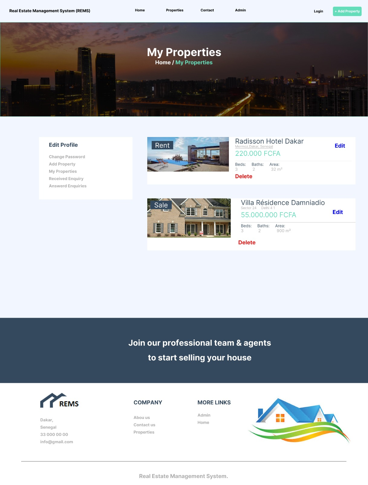
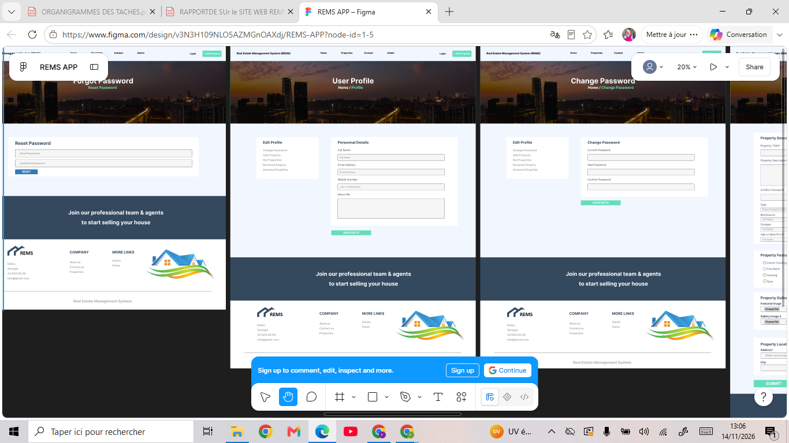

# Fatoumata Binetou DIALLO

### PORTFOLIO ACADÉMIQUE ET PROFESSIONNEL

**Informatique | Développement Web et Mobile | UX/UI et Ergonomie numérique**

---

## 01. PROFIL

Titulaire d'une Licence en Informatique, parcours Web et Mobile, obtenue à l'Université Numérique Cheikh Hamidou Kane en 2024, je souhaite poursuivre mon parcours dans les domaines du design d'interface, de l'expérience utilisateur (UX) et de l'ergonomie numérique.

Ma formation m'a permis d'acquérir des compétences en développement web, en conception d'applications et en gestion de données. Mes expériences universitaires ont également développé mon intérêt pour la conception d'interfaces adaptées aux besoins et aux usages des utilisateurs.

Mon objectif est de mettre à profit mes acquis techniques pour approfondir mes connaissances dans les approches de conception centrées sur l'utilisateur.

---

## 02. PARCOURS ACADÉMIQUE

**Licence en Informatique – Parcours Web et Mobile**

| Informations | Détails |
|---|---|
| Établissement | Université Numérique Cheikh Hamidou Kane |
| Diplôme | Licence en Informatique |
| Parcours | Web et Mobile |
| Année d'obtention | 2024 |
| Mention | Assez bien |

---

## 03. COMPÉTENCES

### Développement web et interfaces

- HTML5 et CSS3
- JavaScript
- Bootstrap
- Responsive Design
- Intégration d'interfaces web

### Gestion des données

- MySQL
- Structuration de bases de données
- Gestion de formulaires et manipulation de données

### Outils informatiques

- Git et GitHub
- Visual Studio Code
- Gestion de projets informatiques

### Compétences transversales

- Travail collaboratif
- Analyse et résolution de problèmes
- Organisation et rigueur
- Communication et adaptabilité

---

## 04. PROJET ACADÉMIQUE DE RÉFÉRENCE

# REMS - Real Estate Management System

**Projet universitaire collectif | Gestion immobilière**

REMS est un projet de plateforme web conçu pour faciliter la gestion des biens immobiliers et améliorer les interactions entre propriétaires et locataires.

### Contribution personnelle

Au sein d'une équipe de cinq personnes, j'ai assuré la coordination de la partie interface utilisateur, tout en participant à la conception et à l'intégration des différentes pages de l'application.

### Principales réalisations

- Conception et intégration de sept pages principales.
- Réalisation des interfaces de présentation et d'ajout de biens immobiliers.
- Participation à la conception des interfaces de gestion des requêtes.
- Réalisation d'un outil de calcul des mensualités.
- Participation à la gestion des médias et des galeries.
- Contribution à la cohérence visuelle et à l'organisation de la navigation.
- Centralisation et suivi du travail collectif sur GitHub.

### Présentation visuelle du projet

**Figure 1 : ACCUEIL**

**Figure 2 : MES PROPRIETES**

**Figure 3 : Formulaires et gestion des requêtes**

**Figure 4 : Statistiques**

*Source : maquette de conception du projet REMS réalisée sur Figma.*

**Lien vers la maquette :** [Consulter le projet REMS sur Figma](https://www.figma.com/design/v3N3H109NLO5AZMGnOAXdj/REMS-APP?node-id=1-5)

---

## 05. PROJET D'ORIENTATION ACADÉMIQUE : UX/UI ET ERGONOMIE NUMÉRIQUE

Mon expérience en développement web m'a permis de comprendre l'importance de la conception des interfaces dans la qualité des interactions entre les utilisateurs et les applications numériques.

Je souhaite approfondir mes connaissances dans les domaines suivants :

**Expérience utilisateur (UX)**

Analyse des usages, compréhension des besoins et amélioration des parcours utilisateurs.

**Design d'interface (UI)**

Conception d'interfaces fonctionnelles, cohérentes et adaptées aux différents supports numériques.

**Architecture de l'information**

Organisation et structuration des contenus pour faciliter leur compréhension et leur utilisation.

**Ergonomie numérique**

Amélioration de l'accessibilité, de la lisibilité et de la facilité d'utilisation des applications.

Cette orientation constitue le prolongement de mon parcours en informatique et répond à mon ambition de contribuer à la conception de solutions numériques centrées sur les besoins des utilisateurs.

---

## 06. CONTACT

**Fatoumata Binetou Diallo**

- **E-mail :** fatimaeyjii@gmail.com
- **LinkedIn :** Fatoumata Binetou Diallo
- **GitHub :** [fatima0828](https://github.com/fatima0828)

---

*Portfolio académique et professionnel — Dossier de candidature universitaire.*
